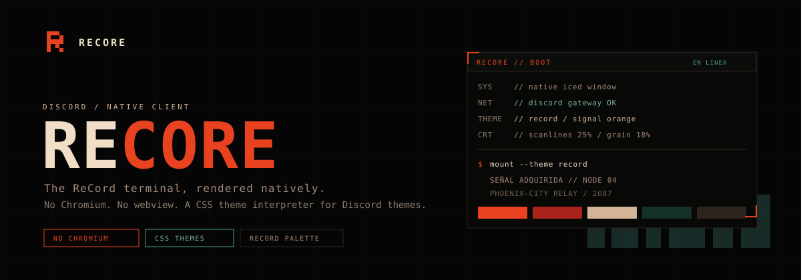

<p align="center">
  <a href="https://leriart.github.io/ReCore/">
    
  </a>
</p>

<p align="center">
  <a href="https://leriart.github.io/ReCore/"></a>
  <a href="https://github.com/leriart/ReCore/releases"></a>
  <a href="LICENSE"></a>
  <a href="https://github.com/leriart/ReCord"></a>
  <a href="https://github.com/yapfast/yapfast"></a>
</p>

<p align="center">
  <strong>A native Discord client with ReCord's terminal look, and a reader for Discord CSS themes.</strong><br>
  Rust and <a href="https://iced.rs">iced</a>, no browser engine, about 30 MB of RAM idle.
</p>

---

> **The short version:** download ReCore, unzip or open it, and scan Discord's QR code from your phone. There is no Chromium, no WebView and no separate browser process. Themes you already use in Vencord, Vesktop, BetterDiscord and friends can become native ReCore themes.

## Install

| Platform | File | What to do |
| --- | --- | --- |
| **Windows 10/11** | `ReCore-…-windows-x64.zip` | Extract the whole ZIP and run `recore.exe`. |
| **Linux** | `ReCore-…-x86_64.AppImage` | Make it executable (`chmod +x`), then open it. |
| **Arch Linux** | `recore-…-x86_64.pkg.tar.zst` | `sudo pacman -U recore-….pkg.tar.zst`. |
| **macOS** | `ReCore-…-macos-arm64.dmg` or `…-macos-x64.dmg` | Drag `ReCore.app` to Applications. The build is ad-hoc signed, not notarised: if macOS refuses it, right-click → Open. |

The [releases page](https://github.com/leriart/ReCore/releases) carries the latest stable files and `SHA256SUMS.txt`. The [landing page](https://leriart.github.io/ReCore/) picks the right download for your computer and shows a live theme preview.

First run links your account by scanning a QR code with Discord's phone app. ReCore keeps the session token in your system's credential store. Voice, screen sharing, GIFs, forums, threads, friends and the rest of the client are there after that.

## Why ReCore?

ReCore is [Yapfast](https://github.com/yapfast/yapfast) with the [**ReCord**](https://leriart.github.io/ReCord/) theme as its own look and a CSS theme interpreter on top. It is not a browser wrapper: every message, menu, dialog and call tile is drawn natively.

- **Native by construction.** Rust and iced; no Chromium, no WebView, no background browser process. Roughly 30 MB of RAM when idle.
- **ReCord, built in.** Signal orange on warm charcoal, Pixel Operator and Pixel Operator Mono, square panels, scanned avatars, scanlines, grain, a vignette, the rolling scan beam and ReCord's stepped motion.
- **ReCore Paper.** The same terminal language in daylight, with a warm paper ground and dark ink.
- **Themes that travel.** Vencord, Vesktop, Equicord, BetterDiscord, Legcord, Dorion, GoofCord, Replugged and ReCord `.theme.css` files become native colours, type, shape, backgrounds and effects.
- **Bundled themes.** ReCore, ReCore Paper, Ambxst, Catppuccin Mocha, Tokyo Night, Nord Aurora, Gruvbox Ember and Solarized Paper ship inside every package. A fresh install has something to choose immediately.
- **Controls, not just colours.** Each theme's custom properties become Appearance controls with labels, groups, defaults and choices inferred from variable names, comments, `@property` and BetterDiscord `@var` metadata.
- **Animated grounds.** CSS `@keyframes` on the page or body can move the window's ground, and CSS gradients and wallpapers from `body` rules are read as backgrounds. DOM-only animations are still left where they belong: in the file.
- **Light on moving pictures.** Animated backgrounds are decoded lazily, scaled by the renderer instead of copied every frame on the processor, and rest while the window is unfocused.
- **ReCord's sounds.** The ReCord set, Kenney's UI sets and the UI SFX themes, with a shared theme, per-sound overrides, playback and volume.
- **Autocorrect when you want it.** An optional word list downloaded on request from Messages, kept on the device. Without it, Spanish accents are still offered under the composer.

## Themes

### The bundled set

| Theme | Look |
| --- | --- |
| **ReCore** | ReCord's signal-orange terminal on charcoal; square, pixel type and CRT effects. |
| **ReCore Paper** | The same palette in daylight. |
| **Ambxst** | Warm Material You rose, rounded panels, Roboto Condensed, quiet shadows and a slow ground drift. Its options mirror the Ambxst shell's surfaces, gradients, shadows, bar, dock and typography. |
| **Catppuccin Mocha** | Midnight base, mauve accent and a soft aurora behind the panels. |
| **Tokyo Night** | Ink-blue city grounds with neon blue, cyan and violet. |
| **Nord Aurora** | Arctic Polar Night and Snow Storm with an aurora-green signal. |
| **Gruvbox Ember** | Warm retro browns, ember orange and a little paper grain. |
| **Solarized Paper** | Solarized's light paper palette with teal and blue signals. |

The theme files live in [`themes/`](themes). Packages copy them into the app's own themes folder; Appearance can also import a theme from a URL or from any of the common client theme folders.

### Use a CSS theme

1. Open **Settings → Appearance**.
2. Choose **Themes folder** and drop a `.theme.css` file there, or paste a theme URL into **Theme URL**.
3. Pick the theme card. **Reload CSS** reads it again after an edit.

ReCore reads:

- Discord's palette tokens: backgrounds, text, accents, status colours, borders, interactive and control tokens, including the newer `--background-base-*`, `--background-surface-*` and `--control-*` names.
- `var()` chains and fallbacks, `!important`, `@import` between local files, `@media (prefers-color-scheme: …)`, `.theme-dark` / `.theme-light`, `@layer`, `@supports`, `@property`, `color-mix()`, `light-dark()`, `lab()`, `lch()`, `oklab()`, `oklch()`, `color(display-p3 …)` and the older colour syntaxes.
- Fonts from `@font-face`, background pictures or videos from `--rl-background-image` / `--background-image` or a `body` background rule, CSS gradients, radius, type, tracking and ReCord's `--rl-*` effects.
- Native region selectors. Discords themes often write `[class*="sidebarList_"] { … }`; ReCore gives its rail, sidebar, chat, member list, header, composer, cards and rows synthetic nodes so those rules have a target.
- Animated grounds. A `@keyframes` animation on the page or body, and its colour/opacity steps, becomes a quiet native wash. Animated gradients become their first frame plus the wash; Discord's DOM-only animations remain in the file.

Remote imports, fonts and pictures are cached in memory and on disk. A changed base theme is picked up by **Reload CSS** without restarting.

The full behavior, including the exact limits of native selectors, is in [docs/themes.md](docs/themes.md).

### Make a theme

A theme is a normal `.theme.css` file. For predictable labels, write a short description beside a property and group a block under a heading:

```css
:root {
  /* Accents */
  --brand-experiment: #ff7a59; /* The main accent */
  --rl-radius: 12px;
  --rl-background-image: linear-gradient(160deg, #101014, #1c1b22);
  --rl-background-dim: 70%;
}
```

Appearance infers a control from the value and its name. A colour becomes a swatch and picker; an opacity becomes a slider; `on`/`off` and ReCord's motion values become buttons or a switch; a `url(...)` gets **Choose…** and **Clear**. BetterDiscord `@var` metadata and `@property` rules are understood too. Changes are kept per theme and exported with **Export changes**.

## Backgrounds and motion

The background slot sits under the panels. **Background dim** is now palette-aware: instead of laying a flat black sheet over the picture, it weights the theme's own grounds, inks and signals by distance and mixes that palette in, as Ambxst's `palette.frag` does. The picture keeps its shapes while settling into the theme. **Background grade** adds Warm, Cool, Mono, Sepia or Scanlines and a 25–200% brightness slider.

| Media | Formats | Playback |
| --- | --- | --- |
| Still pictures | PNG, JPEG, WebP, BMP | Decoded at up to 1280 × 720. |
| Animated pictures | GIF, APNG, WebP | Frames decoded as they fall due; the still shows until the first frame. |
| Video | MP4, WebM, MOV, MKV | Decoded through the bundled FFmpeg path into a capped background animation. |

**Animate background** pauses moving backgrounds when the window is unfocused, away or in low power. The frame is decoded at its source size and the renderer scales it to the window, so returning to the window does not copy a full-window frame on the processor every tick.

CSS themes can name a background through `--rl-background-image`, `--background-image` or a `body` background rule. `body::before` and `body::after` are read too, because that is where many themes keep their wallpaper.

**Why not a separate video engine?** ReCore already decodes video through the bundled FFmpeg path. The expensive parts were copying a full-window frame on the processor every tick and grading it over and over. The frame now stays at its decoded size and the renderer scales it, and the palette table is cached until the theme or dim changes. A native video surface would add a second presentation path and still need the same decode and grade; it is not worth it until the decoder itself can use the GPU. If that lands, it plugs into the same picture player.

## Customise

The themes and accent live in **Settings → Appearance**. The rest of the window is Yapfast's settings: profiles, messages, voice, keybinds, notifications, advanced and about.

`layout.json` in the data folder keeps the choices:

- Linux: `~/.local/share/recore` or `$XDG_DATA_HOME/recore`
- Windows: `%APPDATA%\leriart\ReCore`
- macOS: `~/Library/Application Support/io.github.leriart.ReCore`

The CSS themes folder is `themes` inside that folder.

## Build and run

ReCore builds with Rust 1.97 and the native libraries listed in [`packaging/arch/PKGBUILD`](packaging/arch/PKGBUILD). The pinned Nix shell is the easiest way:

```bash
nix develop path:./nix --command cargo run --locked -- --preview
nix develop path:./nix --command cargo run --locked
```

`--preview` opens the window on Yapfast's fake Discord server, so you can try the themes, backgrounds and calls without an account.

### Without Nix

On Linux with rustup and the system libraries installed:

```bash
cargo run --locked -- --preview   # sample conversations, no account
cargo run --locked                # link an account by QR code
```

The first build compiles bundled FFmpeg, libvpx, dav1d, x264 and LiveKit's WebRTC. That takes a while; later builds reuse the artifacts.

### Checks

```bash
cargo check -p recore-css          # the interpreter, no native dependencies
cargo test  -p recore-css
cargo check --workspace            # the client and its native dependencies
scripts/check --fast
```

The interpreter is `crates/recore-css`; the window's theme plumbing is `crates/recore-iced/src/themes.rs` and `settings/appearance.rs`; the built-in palettes are in `crates/recore-core/src/theme.rs`.

## Release

Releases are built by [`.github/workflows/release.yml`](.github/workflows/release.yml) when a `v` tag is pushed. The workflow builds:

- the Linux AppImage, its `.zsync` file and the Arch package;
- the Windows portable ZIP;
- the Apple Silicon and Intel macOS `.app` ZIPs and DMGs;
- one source snapshot and one `SHA256SUMS.txt`.

The stable signing key is not in the repository. Without `STABLE_SIGNING_KEY` in the release environment the files are published unsigned and the app will not install them automatically. See [docs/packaging.md](docs/packaging.md) for the tag steps and the signing details.

## Troubleshooting

**The window does not open, or closes immediately.**
Run ReCore from a terminal (`./ReCore-*.AppImage`, `./recore`, or `run-recore.cmd` on Windows) so the error stays visible. On Linux, the AppImage needs FUSE 3's `fusermount3`; `--appimage-extract-and-run` works without it.

**A theme looks different in ReCore than in Discord.**
ReCore has no DOM. Colours, fonts, shapes, backgrounds and the page/body animations are mapped; Discord's exact layout, pseudo-elements and element-level animations are not. The note under Appearance counts the files that were read and says what was skipped.

**A background is using too much CPU.**
Turn off **Animate background** or choose a still picture. The renderer scaling and the unfocused pause help, but a high-resolution video still costs something to decode.

**Voice or screen sharing fails.**
Check the microphone and output device under the call's gear. On Linux, screen sharing goes through the desktop portal; PipeWire and a portal implementation need to be running.

**Where are logs?**
`recore.log` in the data folder named above. Never send your password, Discord token or recovery key in a bug report.

## Credits and licences

- **Yapfast**, the client this is forked from, by wiredtenshi and its contributors: GPL-3.0-or-later. The full upstream history is in this repository.
- **Ambxst**, the Quickshell desktop shell by Axenide, whose Material You palette, `palette.frag`, rounded surfaces and shell settings inspired `themes/Ambxst.theme.css`: AGPL-3.0. The theme file is ReCore's own; no Ambxst code is copied.
- **ReCord**, the theme this fork is built around, by leriart: theme code Apache-2.0, companion plugin GPL-3.0-or-later. The signal-pack WAVs are CC0 1.0, original synthesized audio, with the licence in `crates/recore-core/sounds/record/ui/LICENSE.txt`; the Kenney and UI SFX packs are CC0 1.0, with their licences in `crates/recore-core/sounds/packs/`. Pixel Operator by Jayvee Enaguas (HarvettFox96), CC0 1.0; the licence is in `crates/recore-iced-kit/fonts/LICENSE-PixelOperator.txt`.
- **Catppuccin**, **Tokyo Night**, **Nord**, **Gruvbox** and **Solarized** are credited in their theme headers and keep their own licences.
- Yapfast's bundled palettes and assets keep their own licences, as the upstream documentation says.
- ReCore is GPL-3.0-or-later. See [LICENSE](LICENSE).

ReCore is an unofficial fan project. It is not affiliated with Discord Inc., Sad Cat Studios or Thunderful. Discord is a trademark of Discord Inc. ReCord's visual reference is REPLACED; no game assets are included.

## A warning

Third-party clients are against Discord's Terms of Service. In practice Discord rarely bans people for using one, but if losing your account would be a disaster, do not use any third-party client. ReCore keeps to the same limits Discord's own app does and sends no analytics. The login token stays in the system's credential store and goes only to Discord.
