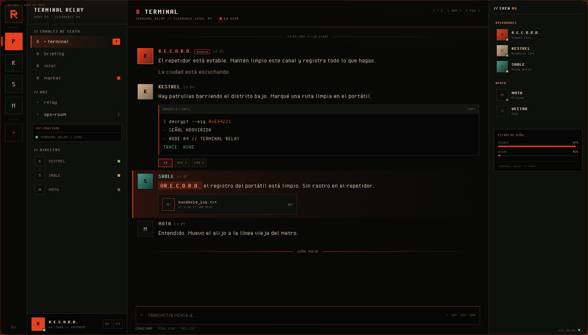
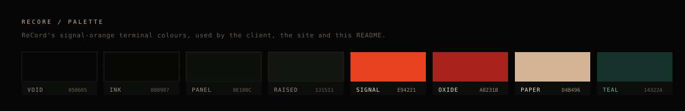

<p align="center">
  <a href="https://leriart.github.io/ReCore/">
    
  </a>
</p>

<p align="center">
  <a href="https://leriart.github.io/ReCore/"></a>
  <a href="https://github.com/leriart/ReCore/releases"></a>
  <a href="LICENSE"></a>
  <a href="https://github.com/leriart/ReCord"></a>
  <a href="https://github.com/yapfast/yapfast"></a>
</p>

<p align="center">
  <strong>A native Discord client with ReCord's terminal look, and a reader for Discord CSS themes.</strong><br>
  Rust and <a href="https://iced.rs">iced</a>, no browser engine, about 30 MB of RAM idle.
</p>

---

<table>
  <tr>
    <td width="33%" valign="top">
      <h3>Native by construction</h3>
      <p>Discord's API, voice and video, drawn in a window made with iced. No Chromium, no WebView and no browser process in the background.</p>
    </td>
    <td width="33%" valign="top">
      <h3>ReCord, built in</h3>
      <p>Signal orange on charcoal, Pixel Operator, square panels, scanned pictures and the same stepped motion as the theme, running natively.</p>
    </td>
    <td width="33%" valign="top">
      <h3>Themes travel</h3>
      <p>Vencord, Vesktop, Equicord, BetterDiscord, Legcord and ReCord <code>.theme.css</code> files become native colours, type, shape and effects.</p>
    </td>
  </tr>
</table>

<p align="center">
  <a href="https://leriart.github.io/ReCore/">
    
  </a>
</p>

<p align="center"><sub>The ReCord terminal language: square rails, pixel type, signal orange and a persistent CRT layer.</sub></p>

## The client

ReCore is [Yapfast](https://github.com/yapfast/yapfast) with the
[**ReCord**](https://leriart.github.io/ReCord/) theme as its own look and a CSS
theme interpreter on top. Servers, DMs, threads, forums, friends, voice, screen
sharing, GIFs and the rest of Yapfast's features are here.

The fork adds:

- **ReCore and ReCore Paper**: ReCord's signal-orange terminal palette in dark
  and paper daylight, with Pixel Operator and Pixel Operator Mono bundled.
- **The complete ReCord look**: square avatars and rail tiles, the 78 pixel
  glyphs, warm scanned avatars, scanlines, grain, vignette, corner brackets,
  the rolling scan beam and flicker.
- **ReCord motion**: a stepped boot signal, power-on, screen-in, channel
  flashes, pulsing unread marks, speaking rings and stepped menus and dialogs.
- **ReCord options in Appearance**: accent presets, motion level, typeface,
  background picture, background dimming, panel opacity, CRT levels and
  switches, low power and avatar filtering.
- **An optional autocorrect word list** for the language you write in,
  downloaded on request from Messages and kept on the device; without it,
  Spanish accents are still offered under the composer.
- **ReCord's sounds** as the `ReCord` sound set in Settings → Sounds:
  call and message sounds, plus interface feedback for hover, menus,
  navigation, typing, send, Escape and the boot signal, with a master
  interface volume and switches for hover, typing and boot.
- **A CSS theme interpreter** for the common Discord theme sources: colours,
  accents, fonts, radius, backgrounds and ReCord's `--rl-*` options. See
  [docs/themes.md](docs/themes.md).

## Backgrounds

ReCore uses the same background slot as ReCord. The picture is placed under
the panels; **Background dim**, **Panel opacity** and the CRT layer sit over
it.

| Media | Formats | Playback |
| --- | --- | --- |
| Still pictures | PNG, JPEG, WebP, BMP | Decoded at up to 1280 × 720 and drawn under the panels |
| Animated pictures | GIF, APNG, WebP | Frames are decoded as they fall due; the still is shown until the first frame |
| Video | MP4, WebM, MOV, MKV | Decoded through the bundled FFmpeg path into a capped background animation |

Choose the file in **Appearance → ReCore window → Choose background**. CSS
themes can name one through `--rl-background-image` or `--background-image`,
and the same media types are accepted. **Background grade** adds None, Warm,
Cool, Mono, Sepia or Scanlines and a 25–200% brightness slider. **Animate
background** pauses moving backgrounds when the window is unfocused, away or
set to low power; still backgrounds never decode frames. The background never
takes pointer input or audio.

## The theme, natively

<p align="center">
  
</p>

The colours are the site's tokens. They are also the values ReCore writes to
`layout.json` and uses in the window:

```css
:root {
  --recore-void:    #050605;
  --recore-ink:     #080907;
  --recore-panel:   #0e100c;
  --recore-raised:  #131511;
  --recore-signal:  #e94221;
  --recore-oxide:   #a8231b;
  --recore-paper:   #d4b496;
  --recore-cream:   #f0dec6;
  --recore-teal:    #14322a;
  --recore-live:    #79b59a;
}
```

ReCord's CSS is included at
[`themes/ReCord.theme.css`](themes/ReCord.theme.css). Dropping it into the
themes folder gives the built-in ReCore colours and fonts. Appearance lists
every option the file exposes: colours become swatches with an HSV picker,
opacity becomes sliders, images get **Choose** and **Clear**, and
`full` / `subtle` / `off` becomes buttons.

The native window matches the parts a native renderer can own: palette, type,
shape, pictures, CRT effects and motion. Discord's web-only selectors,
pseudo-elements and DOM animations stay in the file because there is no DOM
to animate. [docs/themes.md](docs/themes.md) describes the boundary and the
interpreter in detail.

## Build and run

ReCore builds with Rust 1.97 and the native libraries in
[`packaging/arch/PKGBUILD`](packaging/arch/PKGBUILD). The pinned Nix shell is
the easiest way:

```bash
nix develop path:./nix --command cargo run --locked -- --preview
nix develop path:./nix --command cargo run --locked
```

### Without Nix

Or, on Linux with rustup and the libraries installed:

```bash
cargo run --locked -- --preview   # sample conversations, no account
cargo run --locked                # link an account by QR code
```

`--preview` opens the window on Yapfast's fake Discord server. The real client
links an account by scanning Discord's QR code, exactly as upstream does.

## Releases

Releases are built by [`.github/workflows/release.yml`](.github/workflows/release.yml)
when a `v` tag is pushed. The site's Releases section reads GitHub's releases
API and shows the assets. See [docs/packaging.md](docs/packaging.md) for the
tag steps and the signing key.

## Configure

The themes and the accent live in Settings → Appearance. The rest of the
window's settings are Yapfast's: appearance of profiles, messages, voice,
keybinds, notifications, advanced and about. `layout.json` keeps the changes
in the data folder:

- Linux: `~/.local/share/recore` or `$XDG_DATA_HOME/recore`
- Windows: `%APPDATA%\leriart\ReCore`
- macOS: `~/Library/Application Support/io.github.leriart.ReCore`

The CSS themes folder is `themes` inside that folder.

## Development

```bash
cargo check -p recore-css   # the interpreter, no dependencies
cargo test  -p recore-css
cargo check --workspace
scripts/check --fast
```

The interpreter is `crates/recore-css`; the window's theme plumbing is
`crates/recore-iced/src/themes.rs` and `settings/appearance.rs`; the built-in
palettes are in `crates/recore-core/src/theme.rs`.

## Credits and licences

- **Yapfast**, the client this is forked from, by wiredtenshi and its
  contributors: GPL-3.0-or-later. The full upstream history is in this
  repository.
- **ReCord**, the theme this fork is built around, by leriart: theme code
  Apache-2.0, companion plugin GPL-3.0-or-later. The signal-pack WAVs are
  CC0 1.0, original synthesized audio, with the licence in
  `crates/recore-core/sounds/record/ui/LICENSE.txt`. Pixel Operator by Jayvee
  Enaguas (HarvettFox96), CC0 1.0; the licence is in
  `crates/recore-iced-kit/fonts/LICENSE-PixelOperator.txt`.
- Yapfast's bundled palettes and assets keep their own licences, as the
  upstream documentation says.
- ReCore is GPL-3.0-or-later. See [LICENSE](LICENSE).

ReCore is an unofficial fan project. It is not affiliated with Discord Inc.,
Sad Cat Studios or Thunderful. Discord is a trademark of Discord Inc. ReCord's
visual reference is REPLACED; no game assets are included.

## A warning

Third-party clients are against Discord's Terms of Service. In practice
Discord rarely bans people for using one, but if losing your account would be
a disaster, do not use any third-party client. ReCore keeps to the same limits
Discord's own app does and sends no analytics. The login token stays in the
system's credential store and goes only to Discord.
